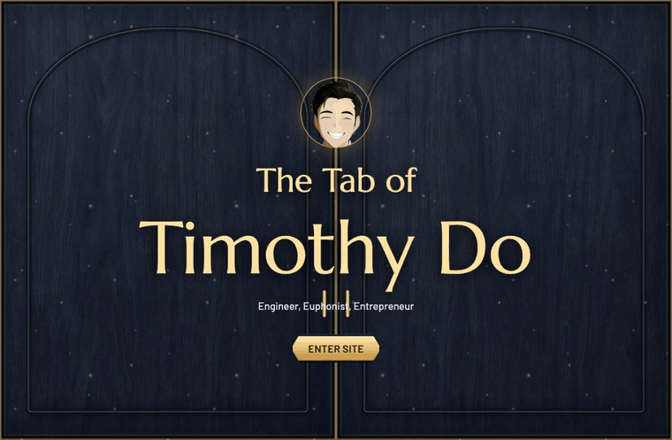
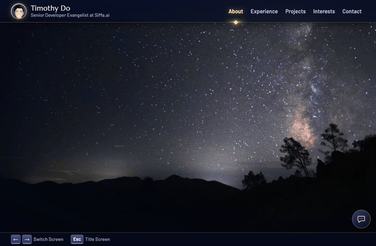
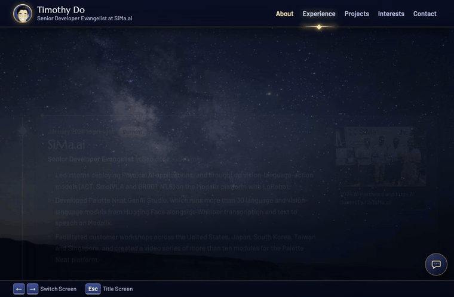
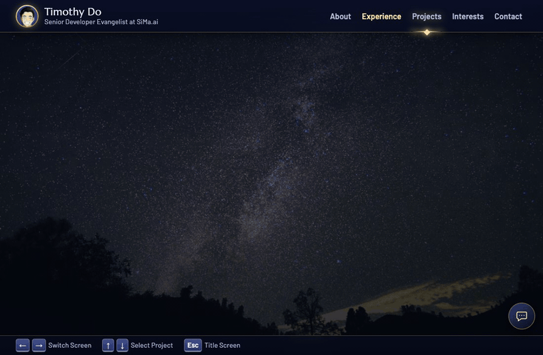
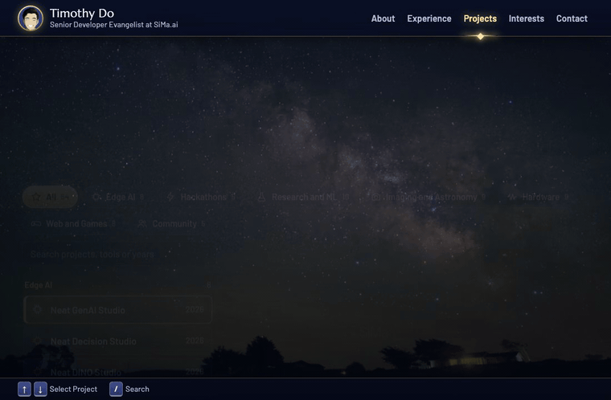
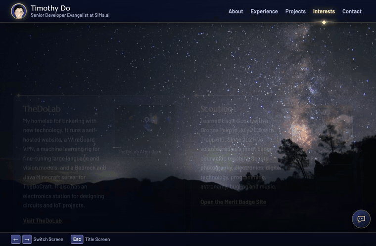
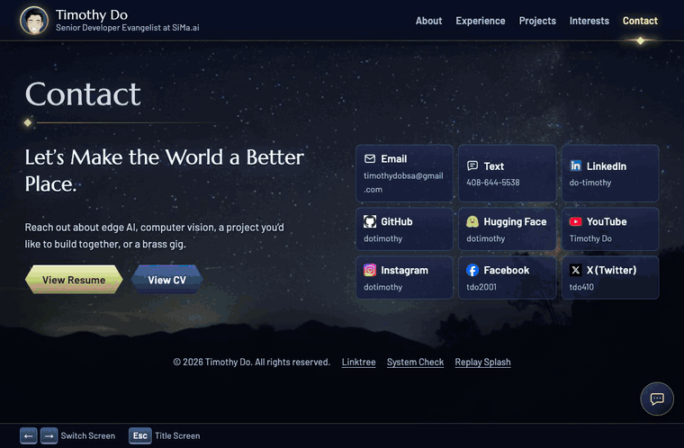
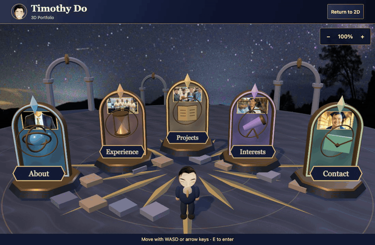
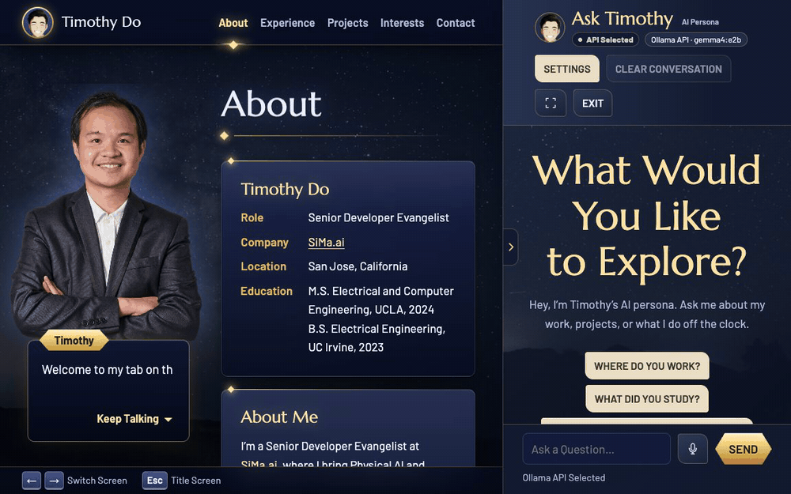

# The Tab of Timothy Do

My personal portfolio brings together the edge AI systems I build, the research behind them, and the photography and music I pursue outside work. Explore it through a keyboard-friendly 2D menu or walk between exhibits in a standalone Three.js world. [Enter the portfolio](https://timothydo.me/) · [Open the 3D map](https://timothydo.me/3d/)

## Enter the Portfolio

Fly through the starfield to the doors and select **Enter Site**. On the title screen, use **↑** and **↓** to choose a section and **Enter** to open it. **Esc** brings you back to the title screen. **Replay Splash** plays the entrance again.



## Tour the 2D Pages

| Page | What to try |
| --- | --- |
| [About](https://timothydo.me/#about) | Select **Keep Talking** for a short introduction, then scroll to my background, skills, and résumé. |
| [Experience](https://timothydo.me/#experience) | Follow the work and education timeline. Select a photo to open it with its caption. |
| [Projects](https://timothydo.me/#projects) | Select a featured project to see its tools, thumbnail, and links. |
| [Full Project Catalog](https://timothydo.me/portfolio/) | Filter by category or search by project name, tool, or year. |
| [Interests](https://timothydo.me/#interests) | Open photos from TheDoLab, scouting, music, and photography. |
| [Contact](https://timothydo.me/#contact) | Find email, social profiles, my résumé, and CV. The [contact directory](https://timothydo.me/contact/) also offers compact icon shortcuts. |

<details>
<summary>About walkthrough</summary>



</details>

<details>
<summary>Experience walkthrough</summary>



</details>

<details>
<summary>Featured Projects walkthrough</summary>



</details>

<details>
<summary>Full Project Catalog walkthrough</summary>



</details>

<details>
<summary>Interests walkthrough</summary>



</details>

<details>
<summary>Contact and contact directory walkthrough</summary>



</details>

## Walk the 3D Map

Select **Explore in 3D** from the title menu. Walk as Timothy with **WASD**, the **arrow keys**, or the on-screen directional buttons. Press **E** near a landmark to enter it, or select the landmark directly. Each exhibit has a thumbnail and controls for browsing its cards.

Use **+**, **−**, or the mouse wheel to zoom. Select the percentage to reset the view. **Board Map** returns to the overview, and **Return to 2D** opens the corresponding portfolio section. Browsers without WebGL can browse the exhibits through text links. [Explore in 3D](https://timothydo.me/3d/)



## Ask the AI Persona

Open the chat bubble to ask about my background and work. For on-device chat, go to **Settings**, choose **WebGPU**, and load a model before sending a question. To use your own server, select **Ollama** or **OpenAI-compatible** under **Chat Backend**, enter the endpoint and model, and apply the settings. API keys stay in the current tab’s memory.

The chat supports Markdown, math, voice input, and spoken replies. Its header tracks time to first token, tokens per second, and generated token count. The recording uses a simulated Ollama response.



## Run Locally

Serve the repository root over HTTP so the browser can load JavaScript modules and local assets. Run this command from the repository directory.

```sh
python3 -m http.server 8000
```

Open [the local homepage](http://localhost:8000/) or [the local 3D map](http://localhost:8000/3d/). To update the project catalog, edit [the shared project data](assets/game/projects.js). The 2D project lists and the 3D Projects exhibit both read from it.
